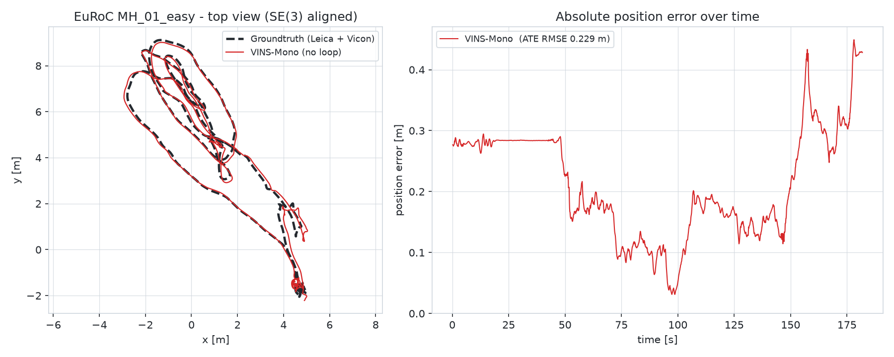
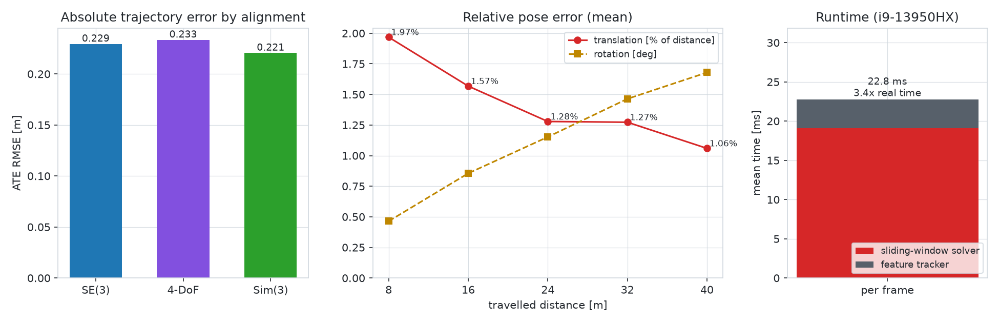

# vins-mono-standalone

[](LICENSE)   

**[VINS-Mono](https://github.com/HKUST-Aerial-Robotics/VINS-Mono) monocular visual-inertial odometry as a standalone C++17 program — no ROS, no catkin, no Ubuntu.**

VINS-Mono (HKUST Aerial Robotics Group) is a widely used optimization-based monocular VIO: KLT feature tracking, robust visual-inertial initialization and a sliding-window bundle adjustment with IMU preintegration, solved with Ceres. Upstream it is a set of ROS 1 packages (two nodes connected by topics), so it needs an Ubuntu machine with a matching ROS distribution — and ROS 1 reached end-of-life in May 2025. This repository keeps the original estimator, feature tracker and camera-model code, removes the ROS dependencies, ports it to Ceres 2.2, and replaces the two ROS nodes with one deterministic driver that reads EuRoC data directly from disk — tested on **Windows 10/11 with Visual Studio 2022 (MSVC) and vcpkg**.

| Original VINS-Mono (ROS packages) | This repo | What changed |
|---|---|---|
| `vins_estimator` (estimator, feature manager, factors, initialization) | `src/vins_estimator/` | ROS headers/messages replaced by `src/common/ros_compat.h`; `ceres::LocalParameterization` → `ceres::Manifold`; MSVC fixes (64-bit pointer keys, no VLAs) |
| `feature_tracker` | `src/feature_tracker/` | parameters from the same YAML; no `imshow` |
| `camera_model` (camodocal) | `src/camera_model/` | pinhole, MEI and Kannala–Brandt models; Boost and the calibration tools removed |
| `feature_tracker_node` + `estimator_node` | `src/app/main_euroc.cpp` → `vins_euroc.exe` | same node logic, executed in one thread without dropping messages |
| rosbag | `src/app/euroc_dataset.cpp` | EuRoC/ASL folder reader |
| `pose_graph` (loop closure), rviz, `ar_demo` | – | not ported: this is **VINS-Mono VIO without loop closure** |

Headline result on **EuRoC MH_01_easy**: ATE RMSE **0.229 m** (SE(3) alignment, 0.29 % of the 80 m path), initialization after **1.3 s**, **no failures/re-initializations**, **3.4× faster than real time** on a laptop CPU, and repeated runs agree to within 0.2 mm. Full numbers are [below](#results-on-euroc-mh_01).

<picture>
  <source media="(prefers-color-scheme: dark)" srcset="docs/images/mh01_trajectory_dark.png">
  
</picture>

---

## Contents

- [Repository layout](#repository-layout)
- [Dependencies](#dependencies)
- [Build](#build)
- [Dataset](#dataset)
- [Usage](#usage)
- [Results on EuRoC MH_01](#results-on-euroc-mh_01)
- [Differences from the original VINS-Mono](#differences-from-the-original-vins-mono)
- [Acknowledgements and license](#acknowledgements-and-license)

## Repository layout

```
vins-mono-standalone/
├── CMakeLists.txt, CMakePresets.json   # plain CMake (no catkin), preset "vs2022-vcpkg"
├── src/
│   ├── vins_estimator/      # VINS-Mono estimator: sliding window, factors, initialization, marginalization
│   ├── feature_tracker/     # KLT tracker + F-RANSAC (namespace ft)
│   ├── camera_model/        # camodocal camera models (pinhole, MEI, Kannala-Brandt)
│   ├── common/ros_compat.*  # minimal replacements for ROS logging / assert / header
│   └── app/                 # main_euroc.cpp (driver = the two ROS nodes), euroc_dataset.* (ASL reader)
├── config/euroc_config.yaml # original VINS-Mono EuRoC configuration + driver keys
├── scripts/
│   ├── setup_vcpkg.ps1      # installs Eigen, OpenCV and Ceres with vcpkg
│   ├── build.ps1            # configures + builds with the CMake preset
│   ├── run_euroc.ps1        # runs one EuRoC sequence and evaluates it
│   ├── run_repeat.ps1       # N parallel runs to measure the run-to-run spread
│   ├── evaluate_euroc.py    # ATE (SE3 / 4-DoF / Sim3), RPE, velocity, biases vs groundtruth + figures
│   └── make_readme_figure.py
├── docs/images/             # README figures
├── results/                 # reference run on MH_01 (trajectory, logs, evaluation) + groundtruth
└── .vscode/                 # build tasks and launch configurations for VS Code
```

`dataset/` (EuRoC data), `output/` (new runs), `build/` and `tools/vcpkg/` (an optional private vcpkg) are created locally and are not part of the repository.

## Dependencies

| Dependency | Used for | Version tested |
|---|---|---|
| Visual Studio 2022 or Build Tools 2022 (MSVC v143, "Desktop development with C++") | C++17 compiler | MSVC 14.44 |
| CMake | build system (presets need ≥ 3.21) | 4.3 |
| Git | cloning this repository and vcpkg | – |
| [vcpkg](https://github.com/microsoft/vcpkg) packages, triplet `x64-windows`: | | vcpkg 2026-06 |
| &nbsp;&nbsp;`ceres` | sliding-window optimization (≥ 2.1, uses `ceres::Manifold`) | 2.2.0 |
| &nbsp;&nbsp;`opencv4` | image I/O, KLT tracking, RANSAC, initialization | 4.12 |
| &nbsp;&nbsp;`eigen3` | linear algebra | 5.0.1 (3.4 also fine) |
| Python 3 with `numpy`, `pandas`, `matplotlib` (optional) | evaluation and figures | 3.13 |

Not needed: ROS, catkin, Boost, Docker, WSL, MSYS2 or Ubuntu.

### Install the dependencies

1. Install **Visual Studio 2022** (Community or Build Tools) with the *Desktop development with C++* workload, **CMake** ≥ 3.21 and **Git** (and Python 3 if you want the evaluation).
2. Clone this repository and, from a PowerShell in its root, run:

```powershell
git clone https://github.com/rafal7466/vins-mono-standalone.git
cd vins-mono-standalone
powershell -ExecutionPolicy Bypass -File scripts\setup_vcpkg.ps1
pip install numpy pandas matplotlib          # optional, for the evaluation
```

The script uses your existing vcpkg if `VCPKG_ROOT` points to one; otherwise it clones and bootstraps a private copy into `tools\vcpkg`. It then runs

```powershell
vcpkg install eigen3 opencv4 ceres --triplet x64-windows
```

A first install compiles everything from source and takes roughly 30–60 minutes; if the packages are already installed it finishes in seconds. To use a vcpkg in another location pass `-VcpkgRoot C:\path\to\vcpkg` and set `VCPKG_ROOT` to the same path.

> **Note:** the vcpkg copy that ships with Visual Studio (`…\VC\vcpkg`, set as `VCPKG_ROOT` inside the *Developer PowerShell*) only supports manifest mode and cannot be used here; the script ignores it and uses `tools\vcpkg` instead.

## Build

```powershell
powershell -ExecutionPolicy Bypass -File scripts\build.ps1
```

or manually:

```powershell
cmake --preset vs2022-vcpkg                      # Visual Studio 17 2022, x64, vcpkg toolchain
cmake --build build --config Release --parallel
```

The build takes 2–3 minutes and produces `build\Release\vins_euroc.exe`; vcpkg copies the required DLLs next to it. `CMakeLists.txt` finds vcpkg through `VCPKG_ROOT`, `tools\vcpkg`, `C:\vcpkg` or `%USERPROFILE%\vcpkg`; you can always override it with `-DCMAKE_TOOLCHAIN_FILE=<vcpkg>\scripts\buildsystems\vcpkg.cmake`.

**VS Code:** open the folder with the *C/C++* and *CMake Tools* extensions, build with `Ctrl+Shift+B` and use the tasks *vins: run MH_01*, *vins: run MH_01 three times (repeatability)* and *vins: evaluate against ground truth (python)*, which expect the data in `dataset\MH_01_easy`.

On Linux the same CMake project builds with `sudo apt install libceres-dev libopencv-dev libeigen3-dev` and `cmake -B build -DCMAKE_BUILD_TYPE=Release && cmake --build build -j`; only the Windows/MSVC path has been tested for this repository.

## Dataset

`vins_euroc.exe` reads the **EuRoC / ASL folder format** instead of rosbags:

```
<sequence>/mav0/
├── cam0/data.csv, cam0/data/<timestamp>.png
├── imu0/data.csv
└── state_groundtruth_estimate0/data.csv     # optional, used for the evaluation
```

All EuRoC files are hosted on the ETH Research Collection ([doi:10.3929/ethz-b-000690084](https://doi.org/10.3929/ethz-b-000690084), linked from the [EuRoC MAV dataset page](https://projects.asl.ethz.ch/datasets/euroc-mav/)). Download the **Machine Hall** archive (ASL format, not the rosbags), extract `MH_01_easy` into `dataset/` and extract its `.zip` in place if it contains one, so that you get:

```
dataset/MH_01_easy/mav0/{cam0, imu0, state_groundtruth_estimate0, ...}
```

`--dataset` (or `dataset_root` in the YAML) may point to the folder that contains `mav0/`, to `mav0/` itself, or to a flattened folder with `cam0/ imu0/`. Images are listed from `cam0/data.csv`, so stray files such as macOS `._*.png` are ignored. Only the left camera is used.

## Usage

### Quick start (PowerShell, EuRoC MH_01)

```powershell
powershell -ExecutionPolicy Bypass -File scripts\run_euroc.ps1 -Dataset dataset\MH_01_easy
```

This runs the whole sequence (≈ 55 s), writes `output\MH_01_easy\` and, if Python with numpy/pandas/matplotlib is available, evaluates it against the groundtruth into `output\MH_01_easy\evaluation\` (`-NoEval` skips that step). Commands must be run from the repository root, because the paths in `config\euroc_config.yaml` are relative to it.

Repeatability check (three runs in parallel, evaluated together):

```powershell
powershell -ExecutionPolicy Bypass -File scripts\run_repeat.ps1 -N 3 -Dataset dataset\MH_01_easy
```

### Direct command line

```powershell
.\build\Release\vins_euroc.exe config\euroc_config.yaml --dataset dataset\MH_01_easy --out output\MH01
python scripts\evaluate_euroc.py --run output\MH01 --gt dataset\MH_01_easy\mav0\state_groundtruth_estimate0\data.csv --out output\MH01\evaluation
```

| Option of `vins_euroc` | Default | Description |
|---|---|---|
| first argument | `config/euroc_config.yaml` | VINS-Mono configuration (original keys + driver keys) |
| `--dataset` | `dataset_root` of the YAML | EuRoC sequence (see [Dataset](#dataset)) |
| `--out` | `output_path` of the YAML | output folder |
| `--start` | `1` | first image (1-based index) |
| `--duration` | whole sequence | length in seconds |
| `--log` | `1` | 0 debug, 1 info, 2 warning, … |

All VINS-Mono parameters (`max_cnt`, `freq`, `max_solver_time`, IMU noise, extrinsics, `estimate_td`, …) keep their original names and meaning in the YAML; the driver adds `dataset_root`, `start_image_index`, `duration_s`, `log_level`, `progress_every` and `save_track_every` (writes images with the tracked features).

### Outputs (`output/<name>/`)

| File | Content |
|---|---|
| `vins_result_no_loop.csv` | trajectory in the original VINS-Mono format: `t[ns], p, q(w,x,y,z), v` |
| `vins_trajectory.csv` | pose, velocity, biases, time offset, segment, number of features, solver time per keyframe |
| `vins_frames.csv` | every frame, including those before initialization |
| `summary.txt` | initialization time, number of failures/re-initializations, real-time factor, mean solver and tracker time, final biases |
| `run_log.txt` | console log |
| `evaluation/` | `metrics_euroc.csv`, `report.txt` and figures (trajectory + ATE, position/velocity, biases vs groundtruth) |

## Results on EuRoC MH_01

The reference run is stored in [`results/MH_01/`](results/MH_01/) (trajectory, logs and evaluation), together with the groundtruth in TUM format ([`MH_01_groundtruth_tum.txt`](results/MH_01_groundtruth_tum.txt)). It uses the original VINS-Mono EuRoC configuration (`freq: 10`, `max_cnt: 150`, sliding window of 10 keyframes, fixed camera–IMU extrinsics) on the full sequence (3682 images, 181.8 s, 80.3 m), Release build, Intel i9-13950HX.

<picture>
  <source media="(prefers-color-scheme: dark)" srcset="docs/images/mh01_metrics_dark.png">
  
</picture>

| Metric | Value |
|---|---|
| Initialization | 1.3 s after the first image, **0 failures / re-initializations** |
| ATE RMSE, SE(3) alignment | **0.229 m** (mean 0.212, median 0.189, max 0.449 m) = 0.29 % of 80.3 m |
| ATE RMSE, 4-DoF / Sim(3) alignment | 0.233 m / 0.221 m (scale 1.015) |
| RPE translation over 8 / 16 / 40 m | 0.16 m (1.97 %) / 0.25 m (1.57 %) / 0.42 m (1.06 %) |
| RPE rotation over 8 / 40 m | 0.46° / 1.68° |
| Velocity error (RMS) | 0.035 m/s |
| Gyro / accel bias error vs groundtruth (RMS) | 0.0007 rad/s / 0.060 m/s² |
| Runtime | 19.1 ms solver + 3.7 ms tracker per processed frame (10 Hz), 3.4× real time |
| Repeatability (4 runs, incl. a fresh clone) | ATE 0.2293 – 0.2295 m |

- *SE(3)* aligns rotation and translation, *4-DoF* only yaw and translation (the unobservable directions of VIO), *Sim(3)* additionally estimates a scale. RPE is computed over 8–40 m of travelled distance, as in the EuRoC/VIO benchmarks.
- For comparison, published ATE values of VINS-Mono **without loop closure** on MH_01 are about **0.15–0.20 m** (e.g. 0.154 m in the [XRSLAM benchmark](https://xrslam.readthedocs.io/en/latest/benchmark.html), 0.202 m in Table II of [MLINE-VINS](https://arxiv.org/abs/2503.01571)). This port is in the same range, slightly above; such numbers depend on the alignment, on which part of the sequence is evaluated and on the CPU (see the next point), so they are only a rough reference.
- **Repeatability.** The driver runs both ROS nodes in one thread without dropping messages, so a run is deterministic except for `max_solver_time: 0.04` (Ceres stops after 40 ms, so the number of iterations depends on the CPU speed). On this machine four runs (one of them from a fresh clone) stayed within 0.2293 – 0.2295 m; on a slower CPU the result can differ slightly more. Set `max_solver_time` large for strictly repeatable runs.
- The full evaluation of the reference run is in [`results/MH_01/evaluation/report.txt`](results/MH_01/evaluation/report.txt); the README figures are regenerated with `python scripts/make_readme_figure.py`.

## Differences from the original VINS-Mono

- The algorithm (feature tracker, initialization, sliding-window estimator, marginalization, failure detection) is the original code. Changes are limited to build and platform issues: ROS headers replaced by `ros_compat.h`; `ceres::LocalParameterization` / `QuaternionParameterization` replaced by `ceres::Manifold` / `QuaternionManifold` (removed in Ceres 2.2, same `Plus()` and Jacobian); `pthread` → `std::thread`; pointer-valued map keys `long` → `long long` (`long` is 32 bit on 64-bit Windows); variable-length arrays → `std::vector`; `abs()` → `std::abs()`.
- **Bug fix:** `Estimator::clearState()` deletes pointers that are only zero-initialized because the ROS node uses a global `Estimator`; as a local object it crashed at random at start-up on Windows. The pointers are now initialized to `nullptr`.
- The two ROS nodes are replaced by `src/app/main_euroc.cpp`, a line-by-line transcription of `feature_tracker_node::img_callback` and `estimator_node::getMeasurements/process` (first-image skip, image-discontinuity restart, `freq` control, IMU interpolation at image time + `td`) in one thread.
- Configurable additions that keep the original behaviour at their defaults: `virtual_focal_length` (VINS-Mono's hard-coded `FOCAL_LENGTH = 460`), the failure-detection thresholds, `solver_threads`, and the compile-time window size `VINS_WINDOW_SIZE` (10, `src/vins_estimator/parameters.h`).
- Not ported: loop closure / `pose_graph`, rviz visualization, the AR demo, the Scaramuzza camera model and the camodocal calibration tools.

## Acknowledgements and license

This repository contains a modified version of VINS-Mono and is therefore released under the [GNU GPL v3](LICENSE), the license of the upstream code; attribution is in [NOTICE](NOTICE). To cite it, use GitHub's *Cite this repository* button (generated from [`CITATION.cff`](CITATION.cff)) and please also cite the original VINS-Mono papers listed below.

This work builds directly on **VINS-Mono** by Tong Qin, Peiliang Li, Zhenfei Yang and Shaojie Shen, HKUST Aerial Robotics Group ([HKUST-Aerial-Robotics/VINS-Mono](https://github.com/HKUST-Aerial-Robotics/VINS-Mono)), and on the **camodocal** camera models by Lionel Heng. If you use this code in academic work, please cite:

- T. Qin, P. Li, S. Shen, “VINS-Mono: A Robust and Versatile Monocular Visual-Inertial State Estimator,” IEEE Transactions on Robotics, 34(4), 2018.
- T. Qin, S. Shen, “Online Temporal Calibration for Monocular Visual-Inertial Systems,” IROS 2018.

EuRoC data: M. Burri et al., “The EuRoC micro aerial vehicle datasets,” IJRR 2016.

Author of the standalone C++ port: **Mohammadreza** ([@rafal7466](https://github.com/rafal7466)), Sharif University of Technology. See also [kalibr-standalone](https://github.com/rafal7466/kalibr-standalone), [svo-pro-standalone](https://github.com/rafal7466/svo-pro-standalone) and [basalt-standalone](https://github.com/rafal7466/basalt-standalone).
